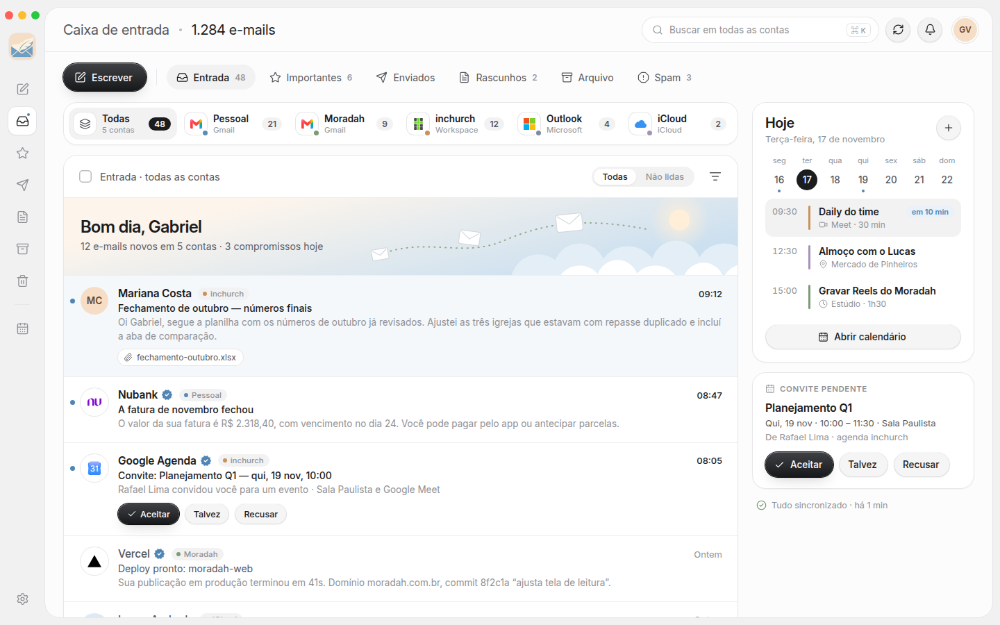

# Quill

App de e-mail e calendário para **macOS**, de uso pessoal. Sem IA.

## O que o app faz

- **E-mail** em várias contas ao mesmo tempo, numa caixa de entrada unificada: Gmail pessoal, Gmail do Moradah, Google Workspace da inchurch, Outlook/Microsoft e iCloud.
  - Ler, responder, encaminhar e escrever.
  - Lixeira, spam, arquivar, marcar como lido e como importante.
  - Pastas, marcadores, anexos e busca.
- **Calendário** nas visões de dia, semana e mês: ver, criar e editar eventos e responder convites.
- **Configurações de contas**: conectar, corrigir e desconectar contas, e ligar ou desligar o e-mail e a agenda de cada uma.

## Situação

Fase de desenho concluída. Ainda não há código.

- Telas (claro e escuro): [`design/telas/`](design/telas/)
- Guia de estilo (cores, fontes, botões, estrutura): [`docs/design.md`](docs/design.md)
- Canvas original no Doop (só pela rede Tailscale): https://sirus-vps.tail6e87c3.ts.net:10001/c/LmKkz1PF7S

## Pastas

| Pasta | Conteúdo |
|---|---|
| `logo/` | Logo aprovado: `quill-claro.png` (fundo pêssego) e `quill-escuro.png` (fundo preto) |
| `referencias/` | Print que inspirou o visual |
| `design/telas/` | Imagens das telas aprovadas |
| `docs/` | Guia de estilo e decisões |
